**3rd-year B.Tech CSE student building things that think, sense and ship — AI agents, security tools, full-stack apps and IoT systems.**

---

### 🔭 COSMIC TELEMETRY
my project star map — tap a project below to explore

| Project | What it does | Stack |
|---|---|---|
| 🌊 [**FloodSenseAI**](https://github.com/Ritvik-io/FloodSenseAI) | U-Net (~7.8M params) on Sentinel-1 SAR imagery maps flood-inundated areas at pixel level; tested on held-out Bolivia region; FastAPI service, 13 Pytest tests, Leaflet dashboard | `Python` `PyTorch` `FastAPI` `Next.js` `TypeScript` |
| 🍯 [**HoneyShield**](https://github.com/Ritvik-io/HoneyShield) | Honeytoken threat detection: decoy files, HMAC-SHA256 signed webhooks with replay rejection, explainable weighted risk scoring, incident-response state machine | `Next.js` `TypeScript` `Node.js` |
| 🛰️ [**multiagent-threat-triage**](https://github.com/Ritvik-io/multiagent-threat-triage) | Local, privacy-first multi-agent system for cybersecurity threat triage and executive reporting, using RAG over PDFs plus live DuckDuckGo search | `LangGraph` `Ollama` `Llama 3.2` `FAISS` `Streamlit` |
| ⚡ [**ENER-GUARD**](https://github.com/Ritvik-io/ENER-GUARD) | Energy-focused project | `TypeScript` |
| ⚖️ [**FairShift**](https://github.com/Ritvik-io/FairShift) | TypeScript project | `TypeScript` |
| 🍽️ [**Savora QR Digital Menu System**](https://github.com/Ritvik-io/Savora-QR-Digital-Menu-System) | User-friendly QR digital menu with an enhanced customer-facing UI | `HTML` |
| 💊 **DoseMate** | Cross-platform medication reminder & tracker with real-time cloud sync; designed in Figma | `Flutter` `Dart` `Firebase` `Figma` |
| 🍔 **DineDash** | Real-time hotel food ordering that sends orders straight to kitchen terminals | `Node.js` `Express` `MongoDB` |
| 🚪 [**MysticDoor**](https://github.com/Ritvik-io/MysticDoor) | Early project (Apr 2025) | — |
| 🏆 [**curry-blasters_AMUHACKS4.0**](https://github.com/Ritvik-io/curry-blasters_AMUHACKS4.0) | AMUHACKS 4.0 hackathon project (fork) | `TypeScript` |

> Browse everything at [github.com/Ritvik-io?tab=repositories](https://github.com/Ritvik-io?tab=repositories).

---

### 📡 SKILL SPECTRUM

---

### 🧭 MISSION LOG

- ⚡ **Industrial Energy Audit Trainee, KR Paper Mill (2025)** — audited boilers, chillers and transformers; analysed power quality and load curves.
- 🤖 **Digital Twin & IoT Workshop, SRM IST (2025)** — 8051 robotics circuit linked to a Unity 3D digital twin over live serial telemetry.
- 🎓 NPTEL: Java (Elite, 87%) · DBMS · 🏆 Best Delegation, VIT MUN 2025 · 🌍 English, Hindi, French (elementary)

---

### 📊 MISSION STATS

---

🚀 Open to internships · Let's build something that lifts off

