 

**3rd-year B.Tech CSE student building things that think, sense and ship — AI agents, security tools, full-stack apps and IoT systems.**

---

### 🔭 COSMIC TELEMETRY

my project star map — tap a project below to explore

| Project | Tech Stack |
|---|---|
| 🌊 [**FloodSenseAI**](https://github.com/Ritvik-io/FloodSenseAI) | `Python` `PyTorch` `FastAPI` `Next.js` `TypeScript` |
| 🍯 [**HoneyShield**](https://github.com/Ritvik-io/HoneyShield) | `Next.js` `TypeScript` `Node.js` |
| 🛰️ [**Multiagent Threat Triage**](https://github.com/Ritvik-io/multiagent-threat-triage) | `LangGraph` `Ollama` `Llama 3.2` `FAISS` `Streamlit` |
| ⚡ [**ENER-GUARD**](https://github.com/Ritvik-io/ENER-GUARD) | `TypeScript` |
| ⚖️ [**FairShift**](https://github.com/Ritvik-io/FairShift) | `TypeScript` |
| 🍽️ [**Savora QR Digital Menu System**](https://github.com/Ritvik-io/Savora-QR-Digital-Menu-System) | `HTML` |
| 💊 **DoseMate** | `Flutter` `Dart` `Firebase` `Figma` |
| 🍔 **DineDash** | `Node.js` `Express` `MongoDB` |
| 🚪 [**MysticDoor**](https://github.com/Ritvik-io/MysticDoor) | 'Unreal Engine' |
| 🏆 [**Curry Blasters – AMUHACKS 4.0**](https://github.com/Ritvik-io/curry-blasters_AMUHACKS4.0) | `TypeScript` |

> Browse all repositories at [github.com/Ritvik-io](https://github.com/Ritvik-io?tab=repositories).

---

### 📡 SKILL SPECTRUM

---

### 📊 MISSION STATS

---

🚀 Open to internships · Let's build something that lifts off

